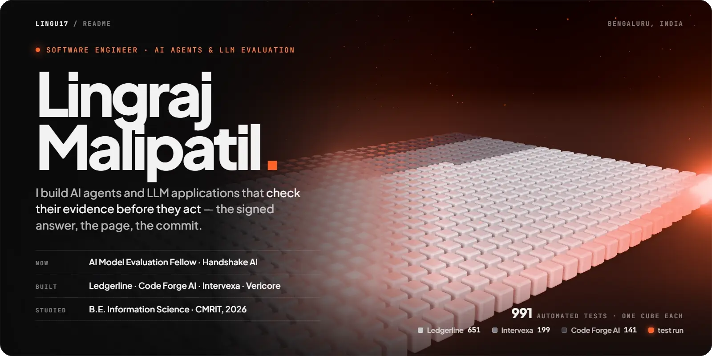
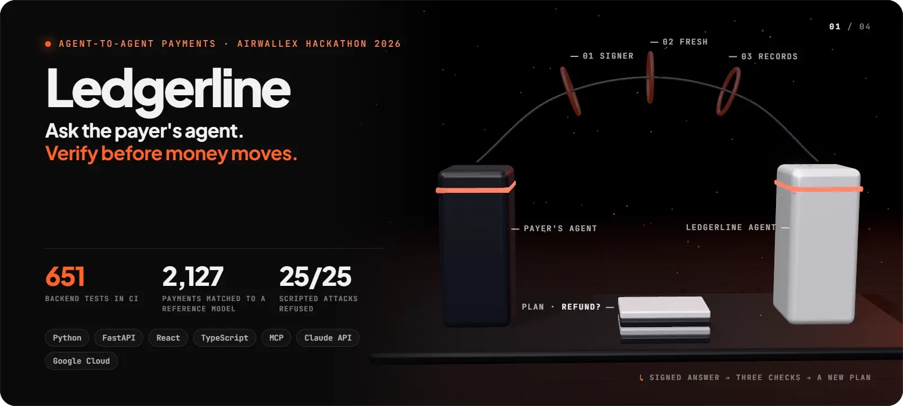
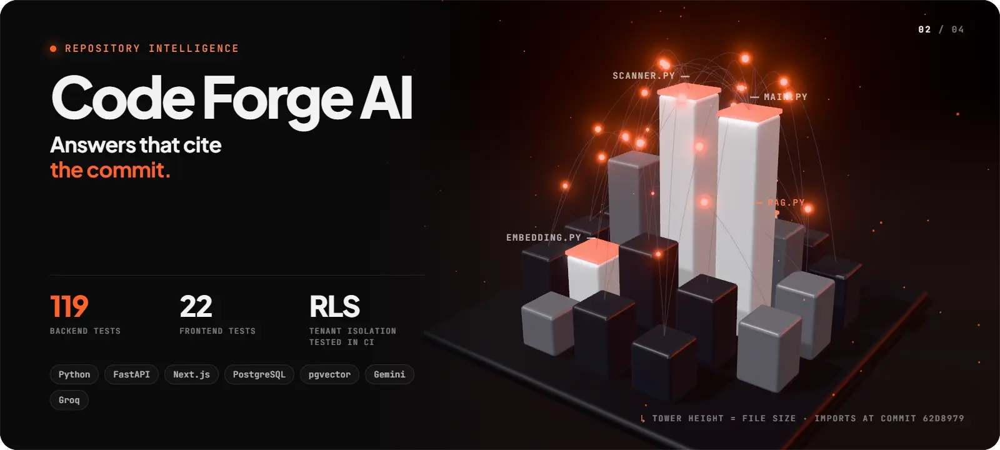
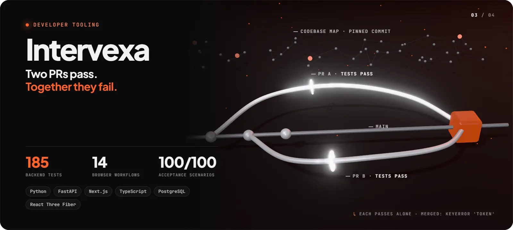
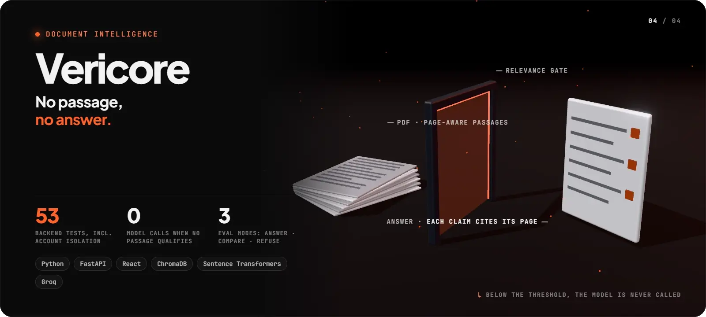

<!-- Every image is a Three.js scene rendered by tools/profile-3d (npm run render). Facts come from the 2026 résumé and github.com/Lingu17/portfolio. -->

<a href="https://lingrajportfolio.netlify.app">
<picture>
  <source media="(max-width: 700px)" srcset="assets/profile/hero-mobile.webp">
  
</picture>
</a>

&nbsp;
&nbsp;
&nbsp;

I'm a software engineer in Bengaluru building AI agents and LLM applications that check their evidence before they act: a payments agent that verifies a signed answer before any money moves, document Q&A that declines when no passage qualifies, and repository answers that cite the commit they came from. I currently design evaluation tasks and scoring rubrics for AI model outputs at Handshake AI.

## Now

- **AI Model Evaluation Fellow · Handshake AI** — Project Octahedron · Oct 2026 – present · Remote 
  Develop evaluation tasks and scoring rubrics that compare AI model responses against defined quality criteria; score outputs for accuracy, instruction following and usefulness, and document the reasoning behind every score.
- **Android AI Developer Intern · MindMatrix.io** — Feb – May 2026 · Bengaluru 
  Built [Shishu-Sneh](https://github.com/Lingu17/Shishu-Sneh), a Kotlin Android app for a baby's growth, vaccinations, feeding and milestones: offline records in Room, WorkManager reminders that survive a reboot, growth charts, PDF reports and Firebase login.
- **B.E. Information Science & Engineering · CMR Institute of Technology** — 2022 – 2026 · CGPA 8.01

## Selected work

<a href="https://github.com/Lingu17/ledgerline">
<picture>
  <source media="(max-width: 700px)" srcset="assets/profile/ledgerline-mobile.webp">
  
</picture>
</a>

**[Live demo](https://35-207-220-110.sslip.io) · [Video](https://youtu.be/FB-SYvdewfA) · [Source](https://github.com/Lingu17/ledgerline)** · Airwallex Agentic Banking Hackathon 2026

When a payment arrives that matches no invoice, Ledgerline's agent asks the payer's own agent, over MCP, what it was for. The signed answer is treated as a claim: it has to pass three checks — who signed it, that it is about this payment and still fresh, and that Ledgerline's own records agree — before the plan changes. Claude reads remittance emails and PDFs as advice only; every money decision comes from rules that a replay reproduces exactly, approvals need two people, and it runs on the Airwallex sandbox with test money only.

Python · FastAPI · React · TypeScript · SQLite · PostgreSQL · MCP · Claude API · Google Cloud

 

<a href="https://github.com/Lingu17/codeforage-ai">
<picture>
  <source media="(max-width: 700px)" srcset="assets/profile/codeforge-mobile.webp">
  
</picture>
</a>

**[Live demo](https://codeforage-ai.vercel.app) · [Source](https://github.com/Lingu17/codeforage-ai)**

Ask a question about a GitHub repository and follow the answer back to the exact file and line, at the commit that was scanned. Retrieval combines pgvector similarity and lexical search, fused by reciprocal rank and scoped to one repository; answers stream with citations; a persisted six-stage scan pipeline recovers interrupted scans, behind Supabase auth and row-level security.

Python · FastAPI · Next.js · PostgreSQL · pgvector · Gemini · Groq

 

<a href="https://github.com/Lingu17/intervexa">
<picture>
  <source media="(max-width: 700px)" srcset="assets/profile/intervexa-mobile.webp">
  
</picture>
</a>

**[Live demo](https://intervexa-three.vercel.app) · [Source](https://github.com/Lingu17/intervexa)**

Two pull requests can each pass their own tests and still break each other. A read-only GitHub App indexes a branch at an exact commit, maps it in 3D (with a 2D view for reduced motion), and compares API contract changes across 2–10 open pull requests. Reproduced on real PRs: one renames a `token` key, the other reads it — both pass alone, combined they raise `KeyError: 'token'`, and Intervexa flagged it. Static findings are advisory by design.

Python · FastAPI · Next.js · TypeScript · PostgreSQL · React Three Fiber

 

<a href="https://github.com/Lingu17/Vericore---Evidence-First-Document-Intelligence">
<picture>
  <source media="(max-width: 700px)" srcset="assets/profile/vericore-mobile.webp">
  
</picture>
</a>

**[Live demo](https://vericore-evidence.onrender.com) · [Source](https://github.com/Lingu17/Vericore---Evidence-First-Document-Intelligence)**

Document Q&A where every claim links back to the page behind it. Hybrid retrieval over PDFs and text files feeds a relevance gate: when no passage qualifies, the API says the information isn't in the documents without calling the model. An evaluation lab tracks retrieval precision, citation coverage and refusals.

Python · FastAPI · React · ChromaDB · Sentence Transformers · Groq

## Competitions

| Event | Entry | Result |
| --- | --- | --- |
| Airwallex Agentic Banking Hackathon 2026 · HackerEarth | [Ledgerline](https://github.com/Lingu17/ledgerline) | All 2,127 synthetic payments matched an independent reference model; 25/25 scripted attacks refused |
| OmniRush Agentic Buildathon 2026 · Unstop | [MergeProof](https://github.com/Lingu17/MergeProof) | Confirms a bug only when two changes pass alone and fail together, with a reproducible evidence bundle |
| RSNA Knee MRI 2026 · Kaggle | Team of three | Final team score 0.939 macro ROC-AUC (winner 0.960) |
| Financial Stress Prediction 2026 · Zindi | Calibrated ensemble | Public score 0.7423 (top 0.7445) |

## More on GitHub

- **[MergeProof](https://github.com/Lingu17/MergeProof)** — tests two changes and their merge in isolated clones, separating real interaction failures from setup errors, timeouts and merge conflicts. Python standard library only.
- **[Opptra Discount Engine](https://github.com/Lingu17/discount-engine-assignment)** — checkout pricing engine for an FDE intern assignment, 27 tests. React · Vite · Claude API · pdf.js · [Live](https://discount-engine-assignment-wine.vercel.app)
- **[Standards research QA pilot](https://github.com/Lingu17/standards-research-eval-pilot)** — LLM evaluation of research questions and prompt injection, with RFC-sourced answer keys and deterministic scoring. Python
- **[Base360 dashboard fixes](https://github.com/Lingu17/New_devs_App/commit/edbe40d)** — multi-tenant revenue bugs: a cache leak, a timezone error and rounding. Python · SQLAlchemy · PostgreSQL
- **[Nexvio](https://github.com/Lingu17/nexvio)** — extended an open-source interview platform with authentication, storage, PDF reports and separate video and speech analysis services. React · Flask · MediaPipe · [Live](https://nexvio-snowy.vercel.app)
- **[Sales Analytics](https://github.com/Lingu17/Sales-Analytics)** — reactive sales dashboard. React 19 · TypeScript · Convex · [Live](https://admired-meadowlark-784.convex.app)
- **[Smart Trip Planner](https://github.com/Lingu17/tourist-system)** — multi-agent travel planning from a plain-language request. Flask · OpenStreetMap · Open-Meteo
- **[Smart Resume AI](https://github.com/Lingu17/Smart-Resume-AI)** — résumé analysis. Flask · Groq · [Live](https://smart-resume-ai-1-vr5g.onrender.com/)
- **[EchoVault AI](https://github.com/Lingu17/ai-chat-app-saved-history)** — chat with saved history. React · Vite · serverless · [Live](https://ai-chat-app-saved-history.vercel.app/)
- **[Revanasiddeshwar Toor Dal Industries](https://msrdi.netlify.app)** — client website with a bulk-quote form. Next.js · Tailwind CSS · Framer Motion
- **[Crop recommendation](https://github.com/Lingu17/Crop-recommendation-using-machine-learing)** and **[emotion detection](https://github.com/Lingu17/Emotion-detiction-using-Text)** — classical ML and NLP. scikit-learn · pandas
- **[Budget Tracker](https://github.com/Lingu17/Buget-tracker-app)** — income and expense tracker in vanilla JavaScript.

## Toolkit

<picture>
  <source media="(max-width: 700px)" srcset="assets/profile/toolkit-mobile.png">
  
</picture>

## How I work

- **An answer is a claim.** An agent's reply, a retrieved passage or a model's output gets checked before anything acts on it.
- **Cite or decline.** Answers point to the file and line, the page, or the signed message they came from — or say plainly that nothing qualified.
- **Pin the revision.** Results record the commit they were computed against, so they can be checked later.
- **Count the tests.** 991 automated tests are documented across Ledgerline, Code Forge AI and Intervexa.

## Contact

Building with LLM agents, retrieval or evaluation? The [contact form on my portfolio](https://lingrajportfolio.netlify.app/#contact) or [LinkedIn](https://www.linkedin.com/in/lingraj-malipatil-a2735a241/) reaches me.

The images on this page are Three.js scenes rendered by [`tools/profile-3d`](tools/profile-3d). Test counts are the documented, passing results in each project's README.
