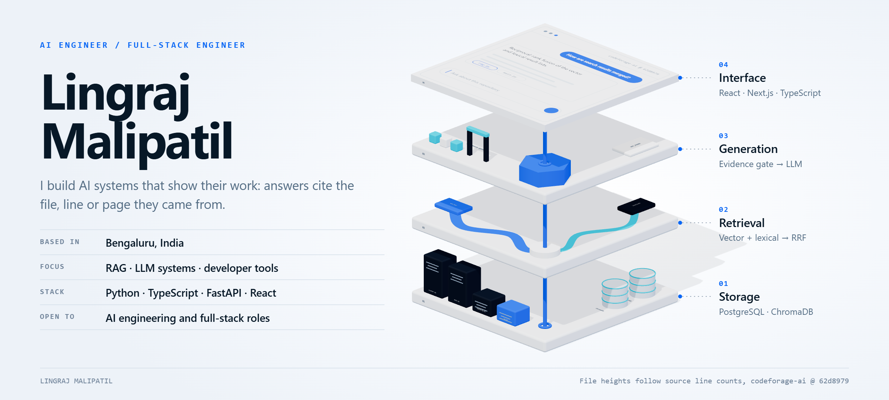
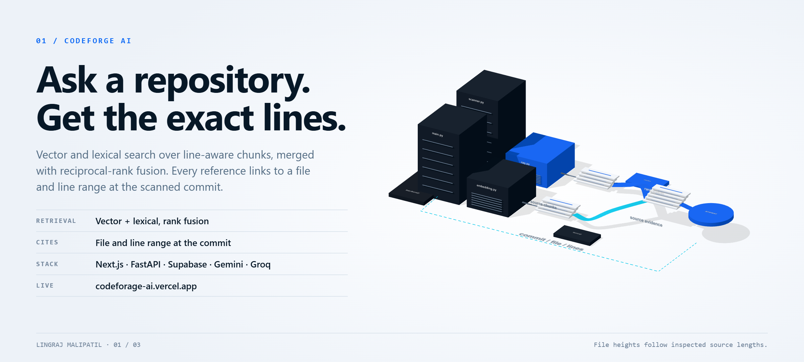
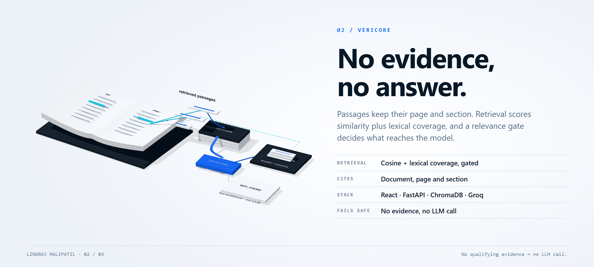
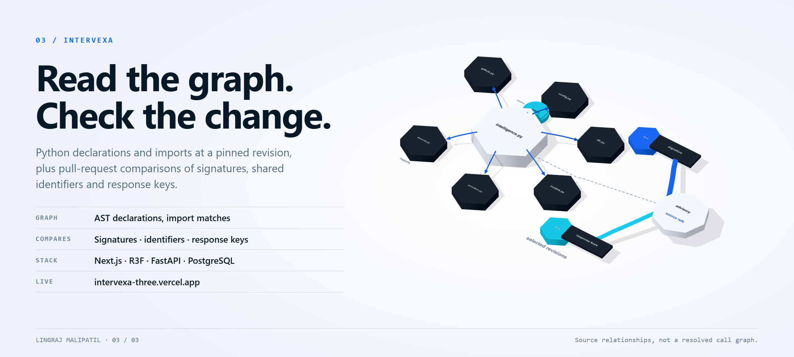
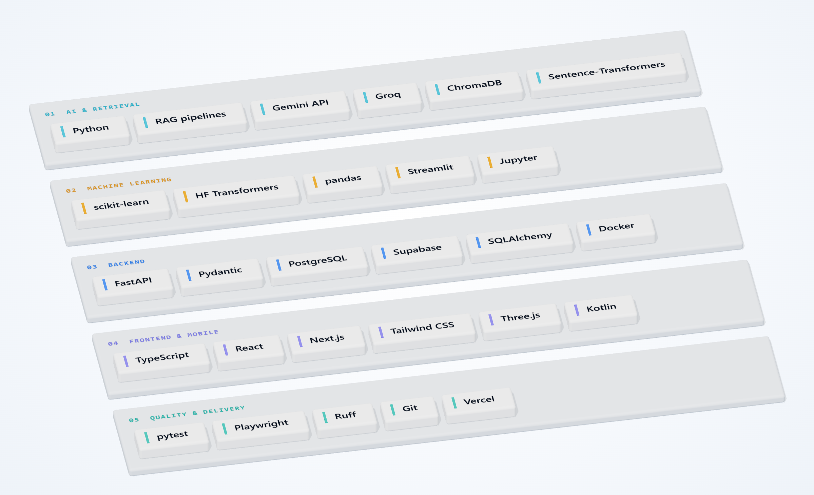

<!-- Every image is a Three.js render: tools/portfolio-3d/render-profile.py writes assets/profile/ (desktop/mobile x dark/light). -->

<picture>
  <source media="(max-width: 700px) and (prefers-color-scheme: dark)" srcset="assets/profile/hero-mobile-dark.png">
  <source media="(max-width: 700px)" srcset="assets/profile/hero-mobile-light.png">
  <source media="(prefers-color-scheme: dark)" srcset="assets/profile/hero-desktop-dark.png">
  
</picture>

I build retrieval-augmented applications and the full-stack products around them. The common thread is traceability: an answer should point to the file and line range, or the page and section, it was built from, and say so plainly when nothing qualifies.

[LinkedIn](https://www.linkedin.com/in/lingraj-malipatil-a2735a241/) · [All repositories](https://github.com/Lingu17?tab=repositories) · Bengaluru, India

## Selected work

### CodeForge AI

<a href="https://github.com/Lingu17/codeforage-ai">
<picture>
  <source media="(max-width: 700px) and (prefers-color-scheme: dark)" srcset="assets/profile/codeforge-mobile-dark.png">
  <source media="(max-width: 700px)" srcset="assets/profile/codeforge-mobile-light.png">
  <source media="(prefers-color-scheme: dark)" srcset="assets/profile/codeforge-desktop-dark.png">
  
</picture>
</a>

**Repository Q&A with line-level citations.** [Live demo](https://codeforage-ai.vercel.app) · [Source](https://github.com/Lingu17/codeforage-ai)

The scanner splits each file into line-aware chunks, caches embeddings and persists every scan stage. At query time, vector and lexical search run over the same chunks and the two ranked lists are merged with reciprocal-rank fusion, so neither retriever's scores need calibrating against the other. Answers stream back with bounded context, and each reference links to a file and line range at the scanned commit.

Next.js · TypeScript · FastAPI · Supabase (Postgres) · Gemini embeddings · Groq 
Start with [`backend/rag.py`](https://github.com/Lingu17/codeforage-ai/blob/main/backend/rag.py) and [`backend/scanner.py`](https://github.com/Lingu17/codeforage-ai/blob/main/backend/scanner.py).

### Vericore

<a href="https://github.com/Lingu17/Vericore---Evidence-First-Document-Intelligence">
<picture>
  <source media="(max-width: 700px) and (prefers-color-scheme: dark)" srcset="assets/profile/vericore-mobile-dark.png">
  <source media="(max-width: 700px)" srcset="assets/profile/vericore-mobile-light.png">
  <source media="(prefers-color-scheme: dark)" srcset="assets/profile/vericore-desktop-dark.png">
  
</picture>
</a>

**Document Q&A that refuses to guess.** [Source](https://github.com/Lingu17/Vericore---Evidence-First-Document-Intelligence)

PDF and text files are chunked with their page and section metadata and indexed in ChromaDB. Candidates are scored on semantic similarity plus lexical coverage, then pass a relevance gate. If nothing qualifies, the API returns *"Information not available in the uploaded documents."* without calling the LLM, so a question the documents can't support never reaches the model.

React · Vite · TypeScript · Tailwind CSS · FastAPI · ChromaDB · Sentence-Transformers · PyMuPDF · Groq 
Start with [`services/retriever.py`](https://github.com/Lingu17/Vericore---Evidence-First-Document-Intelligence/blob/main/backend/app/services/retriever.py) and [`api/chat.py`](https://github.com/Lingu17/Vericore---Evidence-First-Document-Intelligence/blob/main/backend/app/api/chat.py).

### Intervexa

<a href="https://github.com/Lingu17/intervexa">
<picture>
  <source media="(max-width: 700px) and (prefers-color-scheme: dark)" srcset="assets/profile/intervexa-mobile-dark.png">
  <source media="(max-width: 700px)" srcset="assets/profile/intervexa-mobile-light.png">
  <source media="(prefers-color-scheme: dark)" srcset="assets/profile/intervexa-desktop-dark.png">
  
</picture>
</a>

**Repository graph and pull-request change analysis.** [Live demo](https://intervexa-three.vercel.app) · [Source](https://github.com/Lingu17/intervexa)

Explore a repository at a pinned revision as a 3D or 2D graph of Python declarations and module imports. For a selected pair of pull requests, the analyzer compares shared files and identifiers, function signatures and removed response keys, and records the source reference and revision behind each finding. The analysis is static, so findings are advisory: calls aren't resolved, and isolated execution needs a configured runner.

Next.js · TypeScript · React Three Fiber · FastAPI · SQLAlchemy · PostgreSQL · Playwright 
Start with [`app/intelligence.py`](https://github.com/Lingu17/intervexa/blob/main/backend/app/intelligence.py) and [`app/analyzer.py`](https://github.com/Lingu17/intervexa/blob/main/backend/app/analyzer.py).

The project scenes are Three.js models of each workflow, checked against the source in [PORTFOLIO-VERIFICATION.md](PORTFOLIO-VERIFICATION.md).

## Also built

**AI and full-stack**

- **[Nexvio](https://github.com/Lingu17/nexvio)**: interview-video and posture-analysis services with queued processing and task-status endpoints. TypeScript · Python · [Demo](https://nexvio-snowy.vercel.app)
- **[EchoVault AI](https://github.com/Lingu17/ai-chat-app-saved-history)**: React chat app with browser-local history and a serverless model API route. React · JavaScript · [Demo](https://ai-chat-app-saved-history.vercel.app)
- **[Smart Resume AI](https://github.com/Lingu17/Smart-Resume-AI)**: extracts text from PDF/DOCX resumes and returns structured suggestions. Python · Flask · Groq
- **[Smart Trip Planner](https://github.com/Lingu17/tourist-system)**: plans a trip from a plain-language request using open geocoding, weather and attractions data. Python · Flask

**Android**

- **[Shishu-Sneh](https://github.com/Lingu17/Shishu-Sneh)**: tracks a baby's growth, vaccinations, feeding and milestones, with local storage in Room and feeding and vaccination reminders scheduled through WorkManager. Kotlin · Room · WorkManager

**Machine learning**

- **[Emotion detection](https://github.com/Lingu17/Emotion-detiction-using-Text)**: Streamlit app that classifies the emotions in a piece of text with a Hugging Face Transformers pipeline. Python · Transformers · Streamlit
- **[Crop recommendation](https://github.com/Lingu17/Crop-recommendation-using-machine-learing)**: notebook comparing scikit-learn classifiers, from logistic regression to gradient boosting, on soil nutrients and climate readings. Python · scikit-learn · pandas

## Stack

<picture>
  <source media="(max-width: 700px) and (prefers-color-scheme: dark)" srcset="assets/profile/stack-mobile-dark.png">
  <source media="(max-width: 700px)" srcset="assets/profile/stack-mobile-light.png">
  <source media="(prefers-color-scheme: dark)" srcset="assets/profile/stack-desktop-dark.png">
  
</picture>

AI & retrieval: Python, RAG pipelines, Gemini API, Groq, ChromaDB, Sentence-Transformers · Machine learning: scikit-learn, Hugging Face Transformers, pandas, Streamlit, Jupyter · Backend: FastAPI, Pydantic, PostgreSQL, Supabase, SQLAlchemy, Docker · Frontend & mobile: TypeScript, React, Next.js, Tailwind CSS, Three.js, Kotlin · Quality & delivery: pytest, Playwright, Ruff, Git, Vercel

## How I work

- **Cite or decline.** An answer points to a file, line range, page or section, or says that nothing qualified.
- **Pin the revision.** Results record the commit or revision they were computed against.
- **Fail visibly.** Explicit failure states and bounded context instead of silent fallbacks.
- **Test the boundaries.** Tests sit around retrieval, API contracts and analysis limits.

## Contact

I'm open to AI engineering and full-stack roles. [LinkedIn](https://www.linkedin.com/in/lingraj-malipatil-a2735a241/) is the quickest way to reach me.
