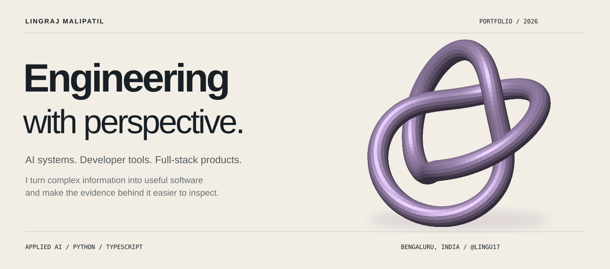
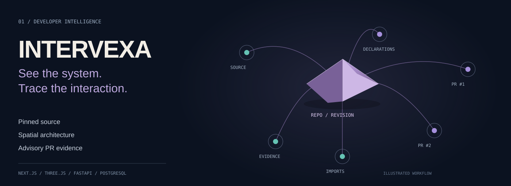
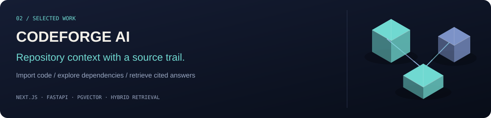
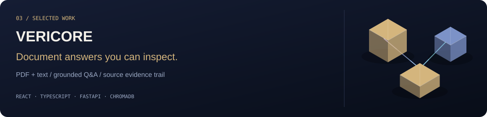
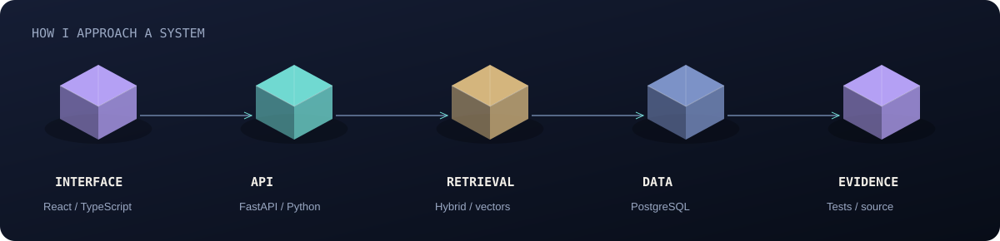

  

  <strong>AI &amp; full-stack software engineering</strong> 
  Repository intelligence · grounded retrieval · developer tools · product interfaces

  <a href="#selected-work">Selected work</a> ·
  <a href="#engineering-focus">Engineering focus</a> ·
  <a href="#repository-directory">All repositories</a> ·
  <a href="https://www.linkedin.com/in/lingraj-malipatil-a2735a241/">LinkedIn</a>

## Software that makes the complex legible

I'm **Lingraj Malipatil**, a developer in India building AI applications and full-stack tools. My recent projects focus on a practical question: **how can software make complex information easier to understand—and make its answers easier to verify?**

I work across interfaces, Python APIs, retrieval workflows, databases and deployment. Below are three projects that best show that work, followed by the full public repository directory.

## Selected work

### 01 / Intervexa - seeing the whole system

Explore revision-pinned code, inspect Python declarations and imports in a 3D workbench, and analyze how selected pull requests may interact.

**Engineering to inspect:** source-aware graph traversal and 2D fallback; selected-repository GitHub App access; persistent analysis queues; immutable revisions; clear separation between static hypotheses and execution evidence.

**Verified in the redesign release:** 185 backend tests, 14 browser tests, production build and GitHub CI. A real two-PR GitHub fixture exercised discovery, synchronization, source search and analysis. Hosted isolated execution remains unconfigured; static findings are advisory.

[Source & product tour](https://github.com/Lingu17/intervexa) · [Live application](https://intervexa-web.onrender.com/) · [Engineering report](https://github.com/Lingu17/intervexa/blob/main/docs/premium-redesign-report.md)

### 02 / CodeForge AI - context with a source trail

Turn repository source into navigable context: import a repository, inspect dependencies and source findings, and ask questions with commit-linked citations.

A developer asks a question. Retrieval finds relevant source. The answer leads back to a recorded commit.

The implementation combines **vector and lexical search**, persisted scan stages and streaming answers. Database authorization, bounded diff review and distinct provider/permission failures make that workflow inspectable.

[Source & architecture](https://github.com/Lingu17/codeforage-ai) · [Retrieval implementation](https://github.com/Lingu17/codeforage-ai/blob/main/backend/rag.py) · [Database isolation checks](https://github.com/Lingu17/codeforage-ai/blob/main/backend/tests/rls_isolation.sql)

### 03 / Vericore - answers you can inspect

Upload PDF or text documents, retrieve relevant material and inspect the evidence behind a grounded answer. Unsupported answers are distinguished from information available in the source documents.

> Information not available in the uploaded documents.

That documented fallback matters: an answer should stay within its evidence. The React/TypeScript workspace exposes source-document and page references, while FastAPI and ChromaDB support extraction and retrieval.

[Source & walkthrough](https://github.com/Lingu17/Vericore---Evidence-First-Document-Intelligence)

## Engineering focus

**Product interfaces** — React, Next.js and TypeScript; responsive navigation, source viewers and useful visualizations.

**Backend & data** — Python, FastAPI, PostgreSQL, pgvector and ChromaDB; persistence, authorization and durable work.

**Applied AI** — hybrid retrieval, embeddings, grounded answers and provider integration.

**Verification** — Pytest, Playwright, type checking, lint, CI and documented test boundaries. Additional projects explore Kotlin, NLP and recommendation models.

I value **inspectable evidence, explicit limits and readable interfaces**. A source reference is more useful than an unsupported claim; a clear recovery state is more useful than a silent failure.

## Repository directory

A directory of my public projects, updated October 11, 2026. It includes product applications, focused machine-learning work and smaller experiments.

### AI & developer platforms

- [Intervexa](https://github.com/Lingu17/intervexa) — repository architecture and PR interaction evidence.
- [CodeForge AI](https://github.com/Lingu17/codeforage-ai) — repository intelligence and source-grounded retrieval.
- [Vericore](https://github.com/Lingu17/Vericore---Evidence-First-Document-Intelligence) — evidence-first document Q&A.
- [Nexvio](https://github.com/Lingu17/nexvio) — AI interview preparation and career intelligence.
- [EchoVault AI](https://github.com/Lingu17/ai-chat-app-saved-history) — AI chat with persisted conversation history.
- [Smart Resume AI](https://github.com/Lingu17/Smart-Resume-AI) — resume analysis and improvement suggestions.

### Applications & dashboards

- [Shishu-Sneh](https://github.com/Lingu17/Shishu-Sneh) — Kotlin Android baby-care tracking and reminders.
- [Tourist System](https://github.com/Lingu17/tourist-system) — destination exploration and travel planning.
- [Sales Analytics](https://github.com/Lingu17/Sales-Analytics) — React/TypeScript dashboard with explicitly simulated sales data.
- [Budget Tracker](https://github.com/Lingu17/Buget-tracker-app) — income, expenses, categories and financial summaries.

### Machine-learning studies

- [Emotion detection from text](https://github.com/Lingu17/Emotion-detiction-using-Text) — NLP emotion classification.
- [Crop Recommendation](https://github.com/Lingu17/Crop-recommendation-using-machine-learing) — recommendations from soil and environmental inputs.

<strong>Profile infrastructure and early experiments</strong>

- [Lingu17](https://github.com/Lingu17/Lingu17) — this profile README and custom SVG portfolio artwork.
- [LinkedIn automation POC](https://github.com/Lingu17/linkedin-automation-poc) — proof-of-concept repository; currently minimal documentation.
- [datacom](https://github.com/Lingu17/datacom) — repository with minimal documentation; no unverified feature claims.

## Let's talk engineering

For a quick technical review, start with **Intervexa's engineering report**, **CodeForge AI's retrieval implementation**, or **Vericore's evidence workflow**. They show the decisions behind the interfaces, not just the screenshots.

[Connect on LinkedIn](https://www.linkedin.com/in/lingraj-malipatil-a2735a241/) · [Browse my repositories](https://github.com/Lingu17?tab=repositories)

---

<strong>Build something useful. Make the evidence visible.</strong> Custom sculptural and editorial SVG artwork · Designed to stay crisp on any screen.

