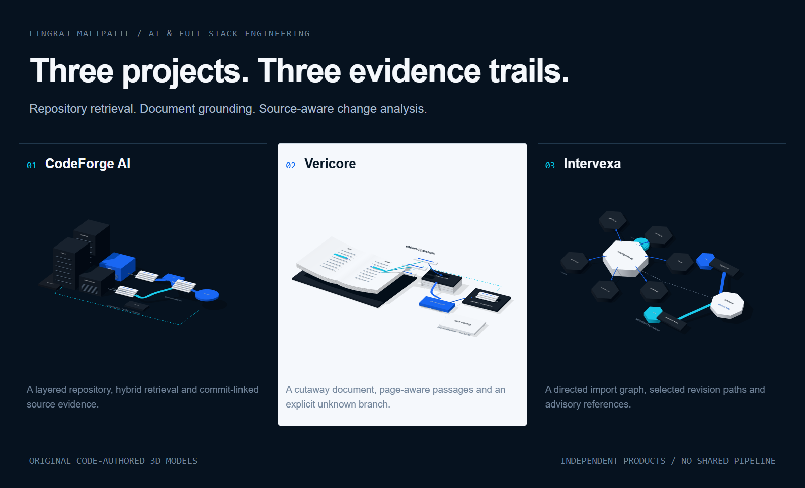
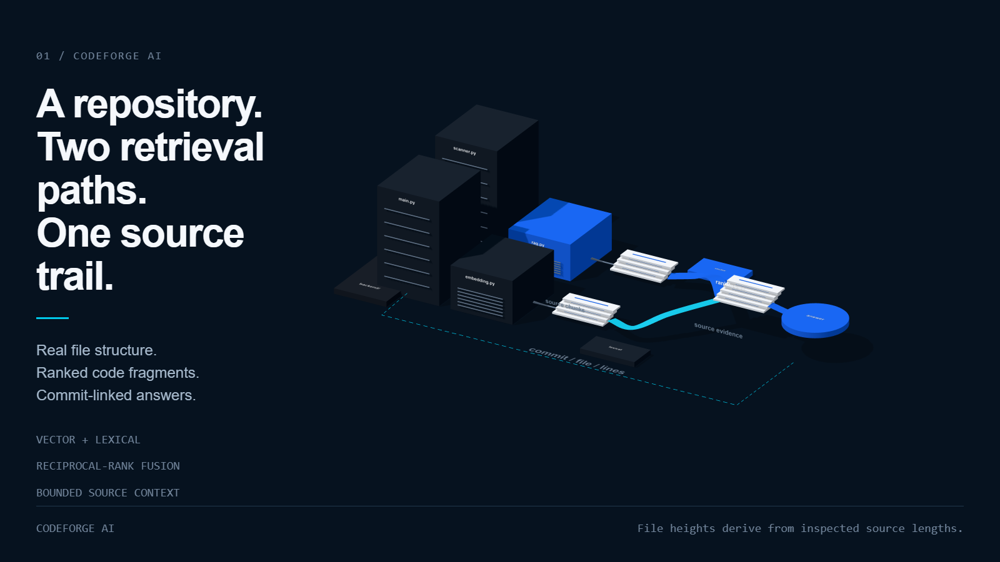
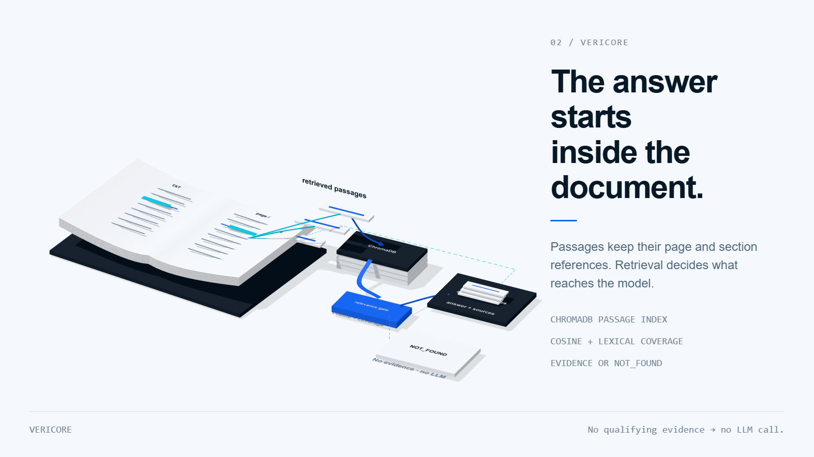
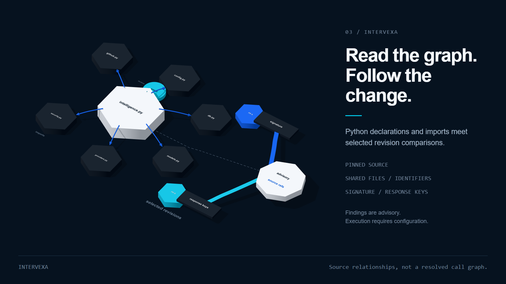

  

## Hi, I’m Lingraj.

I build AI applications and full-stack tools that make complex information easier to inspect. My current work connects answers to repository source, document passages and pinned code revisions.

[LinkedIn](https://www.linkedin.com/in/lingraj-malipatil-a2735a241/) · [GitHub](https://github.com/Lingu17) · [Selected projects](#selected-projects)

## Selected projects

### CodeForge AI

Ask questions about a GitHub repository and follow the answer back to its source. Vector and lexical results are merged with reciprocal-rank fusion, then supplied to the model as bounded, attributed context.

I built line-aware chunking, cached embeddings, persisted scan stages and streaming answers. References link to file paths and line ranges at the scanned commit.

[Repository](https://github.com/Lingu17/codeforage-ai) · [Retrieval implementation](https://github.com/Lingu17/codeforage-ai/blob/main/backend/rag.py) · [Scanner](https://github.com/Lingu17/codeforage-ai/blob/main/backend/scanner.py)

### Vericore

Document Q&A with an inspectable evidence trail. PDF/TXT text is chunked with page and section metadata, indexed in ChromaDB, and retrieved using semantic similarity plus lexical coverage.

The retrieval gate filters unsupported queries before generation. No qualifying evidence means no LLM call:

> Information not available in the uploaded documents.

[Repository](https://github.com/Lingu17/Vericore---Evidence-First-Document-Intelligence) · [Retriever](https://github.com/Lingu17/Vericore---Evidence-First-Document-Intelligence/blob/main/backend/app/services/retriever.py) · [Evidence gate](https://github.com/Lingu17/Vericore---Evidence-First-Document-Intelligence/blob/main/backend/app/api/chat.py)

### Intervexa

Explore pinned repository source and inspect how selected pull requests may interact. The workbench shows Python declarations and module-path import matches, with 3D and 2D views.

Change analysis compares shared files and identifiers, function signatures and removed response keys. Findings include source references and recorded revisions. Static findings remain advisory; calls are unresolved, and isolated execution requires a configured runner.

[Repository](https://github.com/Lingu17/intervexa) · [Source graph](https://github.com/Lingu17/intervexa/blob/main/backend/app/intelligence.py) · [Change analysis](https://github.com/Lingu17/intervexa/blob/main/backend/app/analyzer.py)

## What I work on

- **Retrieval:** code search with rank fusion; document search with lexical grounding and relevance gates.
- **Traceability:** commit-linked code citations, page-aware evidence and pinned analysis revisions.
- **Full-stack delivery:** React/TypeScript interfaces, Python APIs and persistent data.
- **Reliability:** explicit failure states, bounded context and tests around retrieval, APIs and analysis limits.

## Other projects

- [Nexvio](https://github.com/Lingu17/nexvio) — interview-video and posture-analysis services with queued processing and task-status endpoints.
- [EchoVault AI](https://github.com/Lingu17/ai-chat-app-saved-history) — React chat with browser-local history and a serverless model API route.
- [Smart Resume AI](https://github.com/Lingu17/Smart-Resume-AI) — PDF/DOCX extraction and structured resume suggestions through Flask and Groq.

## Get in touch

[LinkedIn](https://www.linkedin.com/in/lingraj-malipatil-a2735a241/) · [Browse my repositories](https://github.com/Lingu17?tab=repositories)
