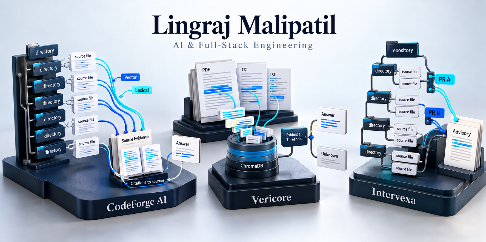
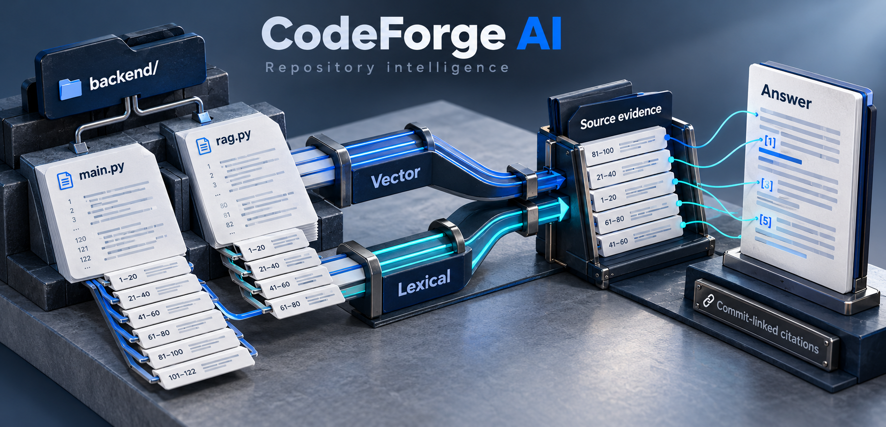
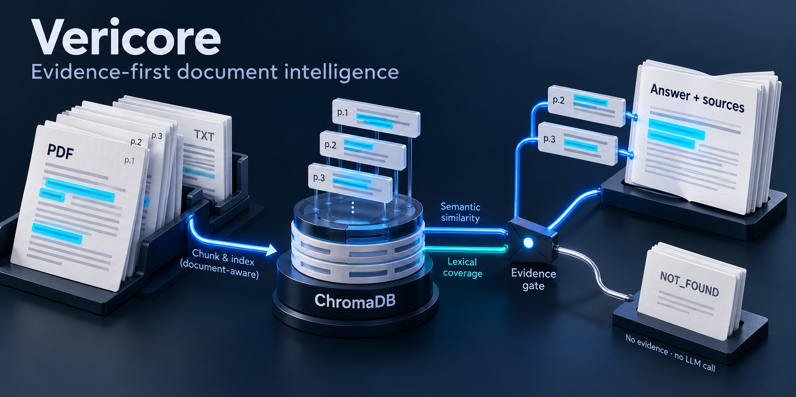
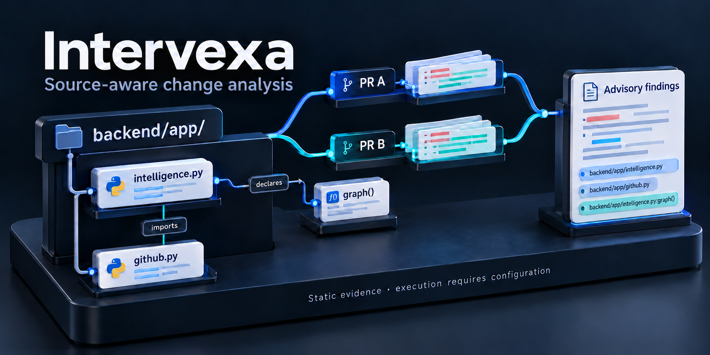

  

# AI engineering with a source trail

I’m **Lingraj Malipatil**. I build tools that make complex information easier to inspect: repository answers with source citations, document Q&A with evidence trails, and developer tools for understanding code changes. I work across React/TypeScript interfaces, Python APIs and retrieval systems.

[Featured projects](#three-products-three-engineering-problems) · [Engineering strengths](#engineering-strengths) · [LinkedIn](https://www.linkedin.com/in/lingraj-malipatil-a2735a241/)

## Three products. Three engineering problems.

### CodeForge AI — ask a repository, follow the sources

*Repository structure → hybrid retrieval → cited answers.*

Import a GitHub repository and ask questions against its source. **Vector and lexical retrieval** are fused into bounded context; answers expose file and line references linked to the scanned commit.

**Engineering detail:** line-aware chunking, cached embeddings, persisted scan stages and streaming answers.

[Repository](https://github.com/Lingu17/codeforage-ai) · [Retrieval code](https://github.com/Lingu17/codeforage-ai/blob/main/backend/rag.py) · [Scanning pipeline](https://github.com/Lingu17/codeforage-ai/blob/main/backend/scanner.py)

### Vericore — document answers with an evidence trail

*Document layers → retrieved passages → answer or explicit unknown.*

Upload PDF or TXT documents, ask questions, and inspect the retrieved passages with document, page and section references. **ChromaDB similarity search plus lexical coverage** selects the evidence supplied to the answer.

**Engineering detail:** relevance gating, passage deduplication and adaptive context sizing. If no evidence passes the gate, the API skips the LLM and returns:

> Information not available in the uploaded documents.

[Repository](https://github.com/Lingu17/Vericore---Evidence-First-Document-Intelligence) · [Retrieval code](https://github.com/Lingu17/Vericore---Evidence-First-Document-Intelligence/blob/main/backend/app/services/retriever.py) · [Evidence gate](https://github.com/Lingu17/Vericore---Evidence-First-Document-Intelligence/blob/main/backend/app/api/chat.py)

### Intervexa — inspect structure and potential change interactions

*Source relationships → selected changes → advisory findings.*

Explore revision-pinned repository structure and Python declarations/imports in a 3D workbench with a 2D fallback. Compare selected PRs for overlapping files and identifiers, signature changes and removed response keys.

**Engineering detail:** source-referenced findings distinguish static evidence from execution results. Import edges use module-path matching; calls remain unresolved. Findings are advisory, and isolated execution requires a configured runner.

[Repository](https://github.com/Lingu17/intervexa) · [Source graph](https://github.com/Lingu17/intervexa/blob/main/backend/app/intelligence.py) · [Change analysis](https://github.com/Lingu17/intervexa/blob/main/backend/app/analyzer.py)

## Engineering strengths

- **Retrieval design:** rank fusion for code; semantic similarity with lexical coverage and relevance gates for documents.
- **Source traceability:** commit-linked code references, page-aware evidence and revision-pinned analysis.
- **Full-stack workflows:** React/TypeScript workspaces backed by Python APIs and persistent data.
- **Reliability and verification:** explicit failure states, bounded context and source-level tests for retrieval, API behavior and analysis boundaries.

## More work

- [Nexvio](https://github.com/Lingu17/nexvio) — interview-video and posture-analysis services with queued processing and task-status endpoints.
- [EchoVault AI](https://github.com/Lingu17/ai-chat-app-saved-history) — React chat UI with browser-local conversation history and a serverless model API route.
- [Smart Resume AI](https://github.com/Lingu17/Smart-Resume-AI) — Flask workflow extracting PDF/DOCX resume text and requesting structured skills, role suggestions and improvement feedback from Groq.

## Contact

[LinkedIn](https://www.linkedin.com/in/lingraj-malipatil-a2735a241/) · [GitHub](https://github.com/Lingu17) · [All repositories](https://github.com/Lingu17?tab=repositories)
